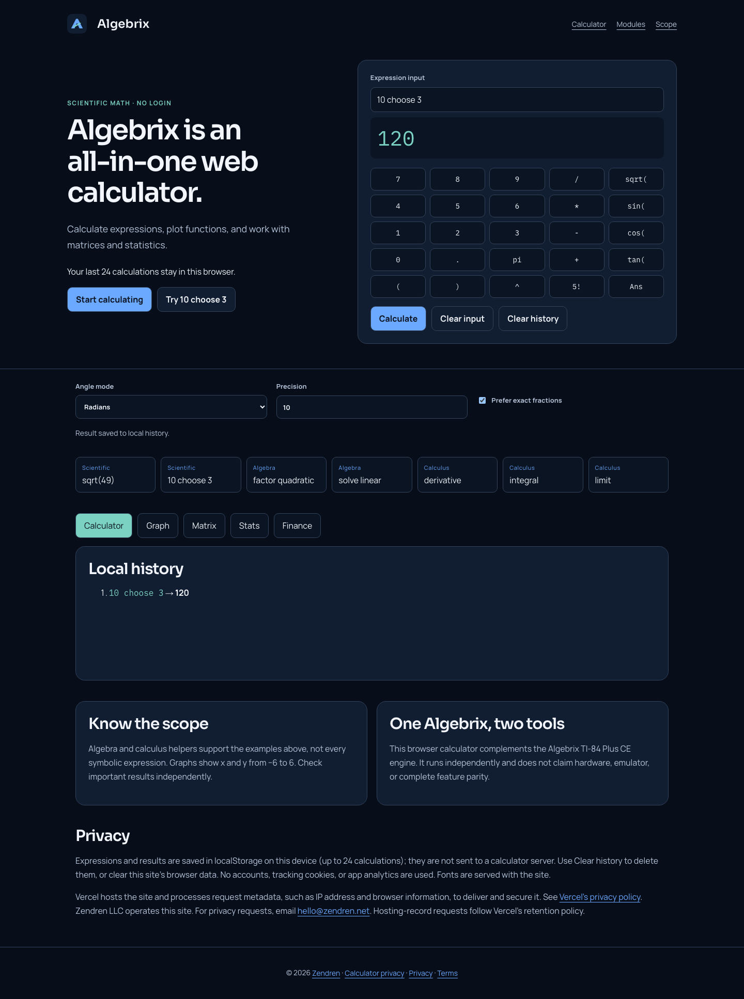

# Algebrix Web

A browser calculator for scientific expressions, algebra helpers, graphs, matrices, statistics, finance and unit conversions.

**Live:** [algebrix.zendren.net](https://algebrix.zendren.net). It is free and needs no login. The Vercel alias [algebrix-eight.vercel.app](https://algebrix-eight.vercel.app) serves the same build. Canonical and share tags point to algebrix.zendren.net.




## Demo


This is a recording of the real production build, not a mockup. Enter `10 choose 3` and press Enter to get `120`; select Graph or Matrix to explore the other modules. The live calculator requires no login.

## Modules

| Module | What it supports |
|---|---|
| Scientific | Arithmetic, powers, parentheses, constants, trig, factorial, combinations and permutations; degrees/radians, precision and exact fractions |
| Algebra and calculus helpers | Examples using `factor`, `solve`, `derivative`, `integral` and `limit`; explicit errors for unsupported expressions |
| Graph | Canvas plot and trace for expressions in x; visible x/y range −6 to 6 |
| Matrix | Determinant, inverse and reduced row echelon form |
| Statistics | One-variable summary statistics and linear regression |
| Finance and units | Future value and length, mass and temperature conversions |
| History | Up to 24 recent expressions/results stored on this device; Clear history deletes them |

Algebrix Web complements the **Algebrix TI-84 Plus CE engine (CalcEngine)**. They are one product story with independent implementations: this site does not emulate TI hardware or promise full engine parity. Verify important results independently.

## Stack

React 19, TypeScript 6 and Vite 8; mathjs for numerical operations and nerdamer for symbolic helpers. Vitest/Testing Library cover calculation logic and UI; Playwright and axe-core cover browser flows, assets, keyboard input and accessibility. Fonts are bundled locally.

**Brand:** Studio family; primary blue `#6ba8ff`, teal `#7bd2c2`; Sora display, Manrope body and IBM Plex Mono. Design tokens are in `src/styles.css`. Brand SVGs are in `public/brand/`.

## Setup and development

Use Node **22.23.3** (`.nvmrc` and `package.json`), then:

```bash
npm ci
npm run dev
```

Open the local URL printed by Vite. For validation:

```bash
npm run check                     # lint, unit tests, TypeScript and production build
npx playwright install chromium   # install the browser once
npm run e2e                       # builds and serves dist on 127.0.0.1:4177
```

Linux may require `npx playwright install-deps chromium` (system administrator privileges). The GitHub Actions workflow in `.github/workflows/ci.yml` runs the same checks on pushes and pull requests.

## Production artifact

```bash
npm run build
node scripts/serve-dist.mjs
```

The latter command serves the production artifact locally on port 4177 with real HTTP 404 responses. `npm run preview` is a Vite convenience server and does not reproduce the hosting 404 rule. Vercel uses `npm ci`, `npm run build` and `dist/`, with filesystem routing followed by the styled `404.html`.

## Configuration and free operation

| Setting | Value |
|---|---|
| Environment variables | None; see `.env.example` |
| Backend / paid API / AI key | None; calculations run locally |
| Storage | Browser localStorage, up to 24 history entries |
| Hosting | Vercel Hobby (free) static project; no paid feature required |

The inputs are editable examples, not simulated AI results. No login or purchase is required. Nothing is simulated, so the app shows no demo banner. The hero states that history stays in this browser.

## Privacy

History uses browser localStorage, not a remote calculation service. Storage failures leave calculations working for the current visit. No app analytics, accounts or tracking cookies are implemented. Hosting still processes request metadata. The site's Privacy section explains processors and deletion. Zendren LLC operates the calculator. Email [hello@zendren.net](mailto:hello@zendren.net) for privacy requests.

## Recreating the evidence

With the production-artifact server running, `node scripts/capture-demo.mjs` records the walkthrough (requires Playwright Chromium). Convert its WebM output to the committed GIF with FFmpeg. `node scripts/lighthouse.mjs` runs a mobile Lighthouse audit using the Linux Playwright browser; the Lighthouse CLI is downloaded by npx. The social card can be regenerated with `python3 scripts/create-share-image.py` (Pillow with WOFF2 font support).

## License

All rights reserved. See [LICENSE](LICENSE). No open-source reuse license is granted.
