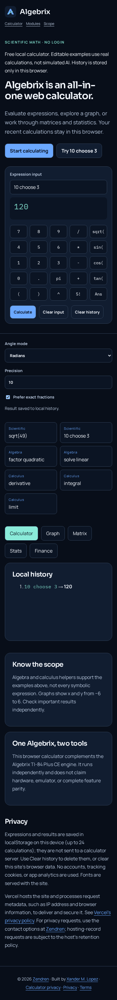

# Algebrix Web

A browser calculator for students and anyone working through scientific expressions, equations, or everyday conversions.

[](https://github.com/XanderXML-Bit/algebrix-web/actions/workflows/ci.yml)

[Open the current hosted Algebrix calculator](https://algebrix.zendren.net).

This checkout contains the public build shown in the walkthrough and screenshots below.

## Demo


Enter `10 choose 3` and press Enter to get `120`. Select Graph or Matrix to try the other tools shown in the walkthrough.




## What it does

| Module | What it supports |
|---|---|
| Scientific | Arithmetic, powers, parentheses, constants, trigonometry, factorials, combinations, and permutations. Settings for angle units, display precision, and exact fractions. |
| Algebra and calculus | Quadratic factoring, polynomial equations in `x`, derivatives, definite integrals, and limits through typed commands. |
| Graph | Canvas plot and trace slider for functions of `x`, with both axes fixed from `-6` to `6`. |
| Matrix | Determinant, inverse, and reduced row echelon form |
| Statistics | One-variable summary statistics and linear regression |
| Finance and units | Future value and length, mass, and temperature conversions |
| History | Up to 24 recent expressions and results saved in the browser |

Algebrix Web runs independently of the Algebrix TI-84 Plus CE engine.

## Stack

React 19, TypeScript 6, and Vite 8. The calculator uses mathjs for expression evaluation, Nerdamer for symbolic helpers, and decimal.js for high-precision approximations.

The Studio palette uses blue `#6ba8ff` and teal `#7bd2c2`. The build bundles Sora, Manrope, and IBM Plex Mono. See [`src/styles.css`](src/styles.css) and [`public/brand/`](public/brand/).

## Architecture

[`src/App.tsx`](src/App.tsx) renders the panels and manages browser storage. In [`src/lib/`](src/lib/), `router.ts` dispatches input to `calculator.ts` for evaluation, `cas.ts` for symbolic commands, or `solve.ts` for equation solving. `format.ts` controls display precision. `toolkits.ts` implements matrix, statistics, finance, and conversion operations.

With exact mode on, `calculator.ts` uses mathjs `Fraction` values for arithmetic with integers and division, such as `1/3 + 1/6`. `solve.ts` converts decimal coefficients to exact fractions and keeps powers of `pi` and `e` symbolic during polynomial construction.

## Quick start

Install Node.js `22.23.3`, the version pinned in [`.nvmrc`](.nvmrc). Run these commands from the repository root.

```bash
npm ci
npm run dev
```

Open the local URL printed by Vite.

## Tests

```bash
npm run check
npx playwright install chromium
npm run e2e
```

`npm run check` runs ESLint, the Vitest suite, and the production build, which includes the TypeScript check. Vitest and Testing Library cover calculation logic and React interactions.

`npm run e2e` builds and serves `dist/` on port `4177`. Playwright checks calculator flows, keyboard input, assets, and the 404 page. It runs axe-core on the calculator panels at mobile and desktop widths.

On Linux, install Chromium and its system dependencies with `npx playwright install --with-deps chromium`. The [CI workflow](.github/workflows/ci.yml) runs the checks on pushes and pull requests.

## Serve the production build

```bash
npm run build
node scripts/serve-dist.mjs
```

Open `http://127.0.0.1:4177`. The local server mirrors the routing in [`vercel.json`](vercel.json) and returns the styled `404.html` with HTTP status `404` for missing paths.

## Configuration

The calculator runs in the browser without a backend, account, or environment variables. See [`.env.example`](.env.example).

## Privacy

The app saves history in `localStorage` and the current expression in `sessionStorage`. Select Clear history and confirm to remove saved history. Clear the site's browser data to remove both. Calculations still work if browser storage is unavailable.

The calculator has no app analytics or tracking cookies. The site's Privacy section describes the request metadata that the host processes. Zendren LLC operates the calculator. Send privacy requests to [hello@zendren.net](mailto:hello@zendren.net).

## Recreate the evidence

Start the production server and install Playwright Chromium before recording the demo or running Lighthouse.

- Run `node scripts/capture-demo.mjs` to record the walkthrough as a WebM in `docs/demo/`. Convert the recording to a GIF with FFmpeg.
- Run `node scripts/lighthouse.mjs` to audit performance and accessibility. The script runs Lighthouse through `npx`.
- Run `python3 scripts/create-share-image.py` to regenerate the social card. The script requires Pillow with WOFF2 font support.

## License

All rights reserved. See [LICENSE](LICENSE). Third-party dependencies and fonts retain their respective licenses.
